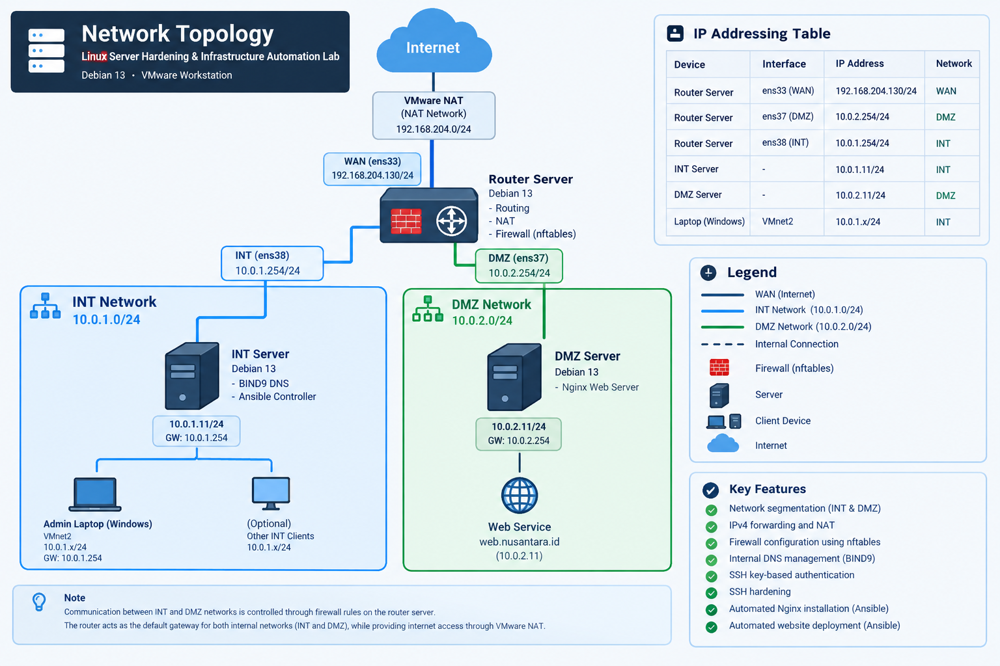

# Linux Server Hardening & Infrastructure Automation Lab

## Overview
## Network Topology

The following diagram illustrates the network architecture
of this homelab project.



# Linux Server Hardening & Infrastructure Automation Lab

## Overview

A personal homelab project designed to simulate a small enterprise network infrastructure using Debian 13 virtual machines.

This project focuses on Linux server administration, network segmentation, firewall configuration, DNS management, SSH hardening, and infrastructure automation using Ansible.

The lab was built using VMware Workstation with three Debian 13 virtual machines acting as a router, internal server, and DMZ server.

## Network Topology

The following diagram illustrates the network architecture of this homelab project.


## Network Architecture

The infrastructure consists of three virtual machines:

| Server | Role | IP Address |
|---|---|---|
| Router Server | Routing, NAT, Firewall | WAN, INT, DMZ interfaces |
| INT Server | BIND9 DNS, Ansible Controller | 10.0.1.11 |
| DMZ Server | Nginx Web Server | 10.0.2.11 |

### Network Segmentation

| Network | Subnet | Gateway |
|---|---|---|
| INT | 10.0.1.0/24 | 10.0.1.254 |
| DMZ | 10.0.2.0/24 | 10.0.2.254 |

## Technologies

- Debian 13
- VMware Workstation
- nftables
- BIND9
- OpenSSH
- Ansible
- Nginx

## Implemented Features

### Network Infrastructure
- Network segmentation using INT and DMZ networks.
- IPv4 forwarding and NAT configuration.
- Inter-network routing.
- Firewall filtering using nftables.

### DNS Management
- Internal DNS server using BIND9.
- Custom internal DNS zone: `nusantara.id`.
- Internal hostname resolution for `web.nusantara.id`.

### Server Security
- SSH key-based authentication using Ed25519.
- Disabled direct root SSH login.
- Disabled password-based SSH authentication.
- SSH hardening on INT and DMZ servers.

### Infrastructure Automation
- Ansible Controller hosted on INT Server.
- Remote server management through SSH.
- Automated Nginx installation.
- Automated website deployment.

## Testing & Validation

The implemented infrastructure was validated through practical testing.

| Test | Result |
|---|---|
| INT to Gateway connectivity | Passed |
| INT to DMZ connectivity | Passed |
| DNS resolution from INT | Passed |
| DNS resolution from DMZ | Passed |
| HTTP access using IP address | Passed |
| HTTP access using internal DNS | Passed |
| SSH key authentication from Windows | Passed |
| SSH password rejection on INT | Passed |
| Ansible connectivity | Passed |
| Nginx service status | Active |
| Nginx boot enablement | Enabled |

### Web Server

The deployed website can be accessed internally through:

- `http://10.0.2.11`
- `http://web.nusantara.id`

### Testing Evidence

Detailed testing results and terminal screenshots are available in:

[`documentation/testing-and-validation.md`](documentation/testing-and-validation.md)

## Repository Structure

```text
linux-server-hardening-lab/
├── ansible/
├── dns/
├── documentation/
│   ├── network-configuration.md
│   ├── security-configuration.md
│   ├── testing-and-validation.md
│   └── topology.png
├── firewall/
├── screenshots/
├── ssh-hardening/
└── README.md
```

## Project Status

**Status: Core Implementation Completed**

Core infrastructure, network segmentation, DNS integration, SSH hardening, firewall configuration, and Ansible-based web deployment have been implemented and tested.

### Future Improvements

- Server monitoring and observability.
- Additional security testing.
- Backup and recovery automation.
- Infrastructure automation improvements.
- More comprehensive technical documentation.

## Author

Personal Linux Infrastructure & Server Administration Project.

Built as a hands-on learning project to improve practical skills in Linux system administration, networking, infrastructure security, and automation.
- Infrastructure documentation.

## Author

Personal Linux Infrastructure & Server Administration Project.
